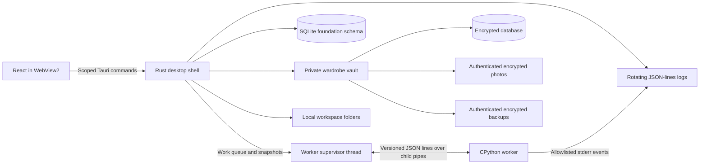

# Architecture

## Implemented flow

| Boundary | Ownership |
| --- | --- |
| Desktop lifecycle and configuration | `desktop.rs` controls Tauri startup, commands and teardown. `config.rs` picks the worker executable and defines IPC timing. |
| Worker and health | `worker/mod.rs` owns the supervisor, state transitions, retry and periodic health checks. `worker/process.rs` owns pipes and process cleanup. `worker/job.rs` attaches the process to a Windows Job Object. |
| Wire format | `protocol.rs` defines and validates Rust messages. `python-worker/worker.py` implements its side of the documented protocol. |
| Persistence and media | `storage.rs` resolves roots and initializes the technical schema. `wardrobe/database.rs` owns SQLCipher and migrations. `wardrobe/service.rs` acquires the vault lease and coordinates transactions. `images.rs` and `wardrobe/media.rs` control relative references, validation and encrypted image variants. |
| Key management and backup | `security.rs` owns key derivation, DPAPI and passphrase recovery. `wardrobe/backup.rs` verifies and streams encrypted archives. |
| Diagnostics | `diagnostics.rs` permits enumerated event codes and timings only. SQLite and worker failures have explicit status or error codes. |
| Interface | React owns navigation, status, forms and in-memory previews. The `src/wardrobe/` view uses the scoped Rust commands in `wardrobe/commands.rs`. Worker lifecycle, database operations, encryption, image processing and backup run outside the UI thread. |

The release embeds the built frontend. Tauri hosts it with its local application protocol and exposes no TCP service. The Vite server is development-only and binds loopback. The Rust wardrobe works independently of Python. WebView2 is a Windows runtime prerequisite. Its OS-managed updates are independent of FitSense.

## Future boundaries

Python will own model-input preprocessing and ONNX Runtime CPU sessions. Configure models through a versioned local manifest and load them on demand. Use PyTorch only in the development and conversion environment. Keep recommendation rules, feature inputs and ranking tests in a dedicated domain module that can be exercised without a WebView or Python process. Cross the existing IPC boundary only for work that needs Python. These modules begin when the product has real inference and ranking work to implement.

Target Windows 10 and 11 x64 with 8 GB RAM or more. Measure startup, idle memory and model-load peaks on an actual 4 GB system before publishing any reduced-memory support claim.

## Decisions

- [ADR 001 · Use a supervised Python process over stdio](adr/001-worker-transport.md)
- [ADR 002 · Gate personal persistence on encryption](adr/002-local-encryption.md)
- [ADR 003 · Encrypt the wardrobe with SQLCipher](adr/003-database-encryption.md)
- [ADR 004 · Pair user-scoped DPAPI with a recovery passphrase](adr/004-key-management-and-recovery.md)
- [ADR 005 · Store immutable authenticated image variants](adr/005-encrypted-image-storage.md)
- [ADR 006 · Stream an authenticated backup and publish restores atomically](adr/006-backup-and-restore.md)
